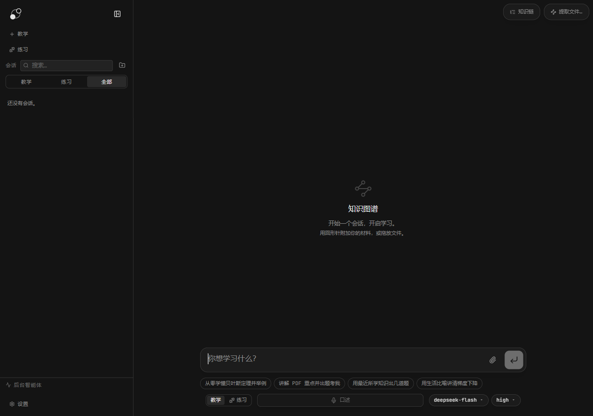
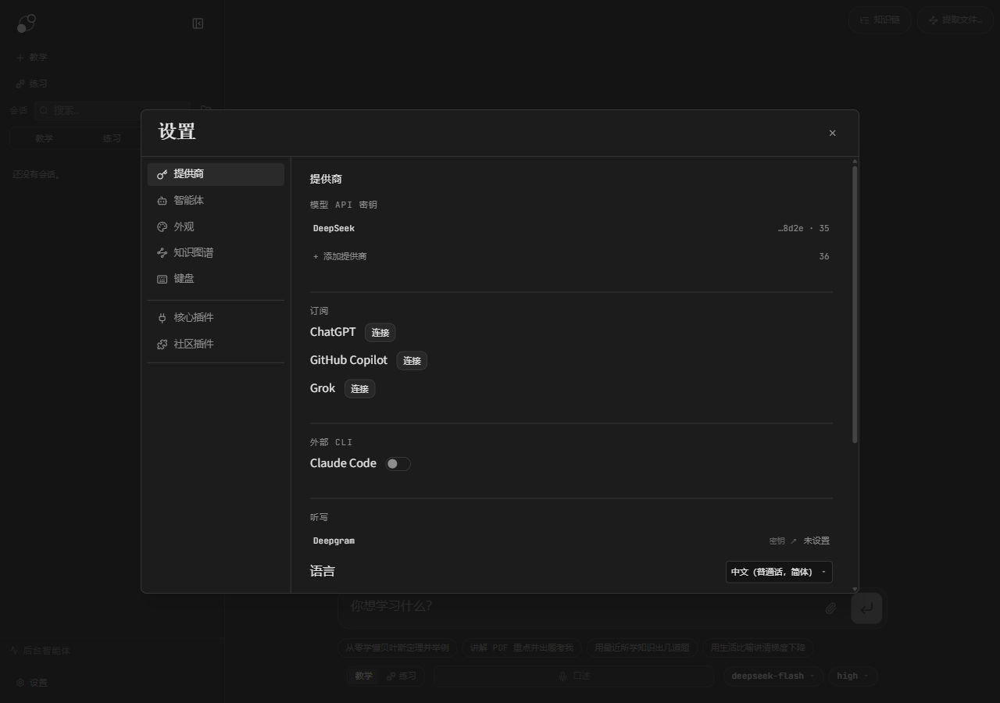

<p align="right">
  <a href="README.md">简体中文</a> ·
  <a href="README.en.md">English</a> ·
  <a href="README.ja.md">日本語</a>
</p>

<p align="center">
  
</p>

<p align="center"><strong>An agent harness for learning.</strong></p>

<p align="center">
  <a href="https://github.com/xipantingfeng/learn-harness-zh/releases/latest">Download</a> ·
  <a href="#highlights">Highlights</a> ·
  <a href="#how-it-works">How it works</a> ·
  <a href="docs/README.md">Documentation</a> ·
  <a href="https://github.com/xipantingfeng/learn-harness-zh/issues">Issues</a>
</p>

Zhixue 1.0 uses AI agents to plan lessons from your current understanding and updates that picture as you learn. It does more than produce explanations: your answers, confidence, and thinking decide what comes next — another step, a different example, or a problem. What you learn accumulates in a persistent knowledge graph that carries across sessions.



## Highlights

- **A visible plan.** Teaching starts with a dependency map and a confirmation card you can approve or revise before the lesson begins.
- **Reply-level actions.** Simpler, more detail, another example, “I don't get it”, summarize, quiz me — each prefills the composer and never sends on your behalf.
- **One-line examples.** Four concrete prompts sit on a single row on the home screen; a click fills the composer and it is ready to send.
- **Knowledge that carries forward.** Propositions and reasoning chains are stored with links back to their source sessions, so later teaching and practice read the graph instead of starting over.
- **Local first.** Chats, graph, settings, and keys stay on your machine. In-app updates are disabled by default.
- **Three platforms.** Ready-to-run packages for Windows, Linux, and macOS. On Windows, unpack the archive and run `知学.exe`.

## How it works

1. **Measure.** Before teaching, the agent finds where your understanding ends on each part the lesson depends on. Your answers, confidence, and thinking show it where to start.
2. **Plan.** It builds a dependency map from that starting point to your goal. The plan is visible, and the lesson adapts when your understanding turns out different.
3. **Teach.** Each step builds on something you already understand. You predict, get an explanation, and check your understanding. Confusions are repaired before anything is built on them.
4. **Practice.** Separate sessions pose varied problems that require the right knowledge to come to mind without being named first. Problems and hints adapt to your reasoning.

**Think out loud.** The thinking fields let you explain your reasoning, uncertainties, and reactions in your own words. That is how the agent gets a detailed picture rather than a record of right and wrong answers. Type or dictate.

**Bring your files.** In the desktop app, attach PDFs, photos, or other files with the paperclip, or drag them in. The file stays where it is; the message carries its path and the agent reads it from there.

The agent can also research in the background, create visual explanations, mark up your own images in the lesson (including figures cropped from PDFs), and build interactive demonstrations.

## Knowledge that carries forward

Teaching accumulates as propositions and reasoning chains: claims and the premises that lead to them. The graph shows that structure with links back to source sessions. You can import notes too.

Future teaching sessions read the graph rather than starting from scratch, and practice sessions draw their material from it. It stores ideas and connections, not ratings of your ability.


## Download and get started

**[Download from GitHub Releases](https://github.com/xipantingfeng/learn-harness-zh/releases/latest)**

- **Windows (x64):** unpack the archive and run `知学.exe`. No installer, no Node.js, no dependency downloads.
- **Linux (x64):** unpack and run `bash run.sh`, or make `zhixue` executable and run it directly.
- **macOS (Apple Silicon / Intel):** unpack and open `知学.app`. If Gatekeeper blocks it, right-click and choose Open. `安装.command` sets the executable bit.

Choose your models, then start a session with what you want to understand. Provider API keys, desktop subscription connections, an installed Claude Code CLI, or a custom OpenAI-compatible endpoint (including a local model server) are supported. Dictation and web search use separate service keys.

Model and key settings live in one place, with Chinese labels and status throughout the interface:



See [Getting started](docs/getting-started.md) and [context, caching, and costs](docs/compaction-accounting.md) for more.

## Your keys, your data

- **Your keys and models.** No subscription or markup. Billing depends on your provider, CLI, subscription, or local setup. The cost meter estimates known API costs only.
- **Local storage.** Chats, graph, settings, and keys live under `%APPDATA%\知学`. Learning records are plain inspectable files.
- **External services.** Models run through your configured providers; web research and dictation also contact external services. Local storage does not mean offline processing.
- **Inspectable behavior.** System prompts are visible and editable. The app is open source under AGPL-3.0.

## Development and support

```bash
npm ci
npm run plugins:setup
npm run dev        # http://localhost:3000
npm test           # fixtures and fake providers
```

More guides: [documentation index](docs/README.md), [development](docs/development.md), [architecture](docs/architecture.md), [keyboard shortcuts](docs/keyboard.md), and [desktop builds](docs/zh-CN/build-windows.md).

Questions and bug reports: [GitHub Issues](https://github.com/xipantingfeng/learn-harness-zh/issues). Report security issues privately as described in [SECURITY.md](SECURITY.md).

## License

[AGPL-3.0](LICENSE). Includes code from LearnHarness; attribution and modification notes are in [NOTICE](NOTICE). The app is free and open forever; if convenience services are ever charged for, local features never will be.
