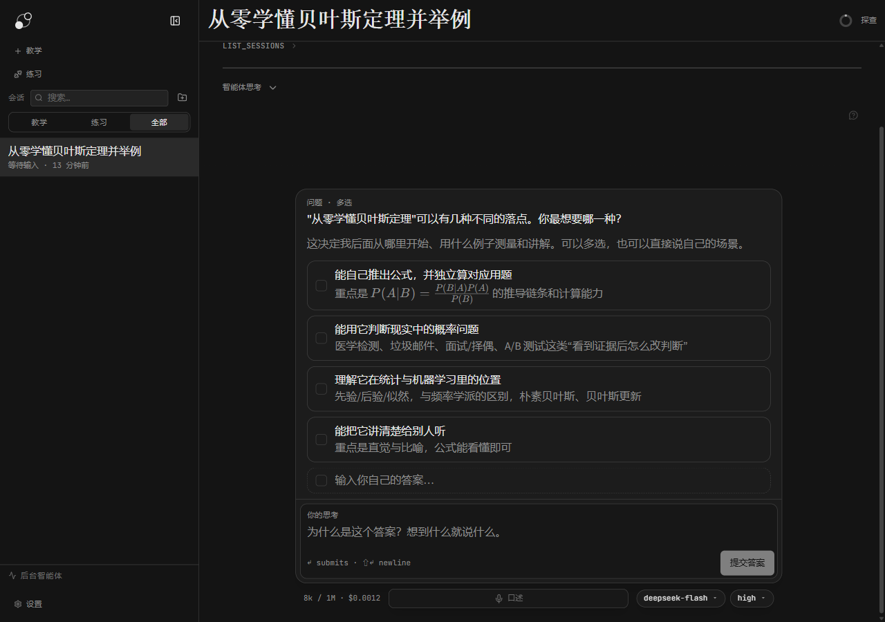
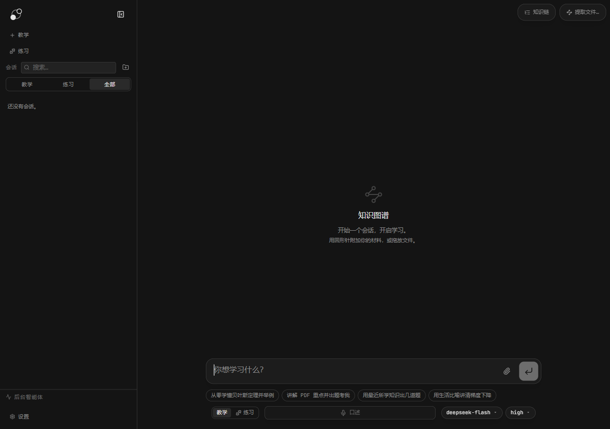
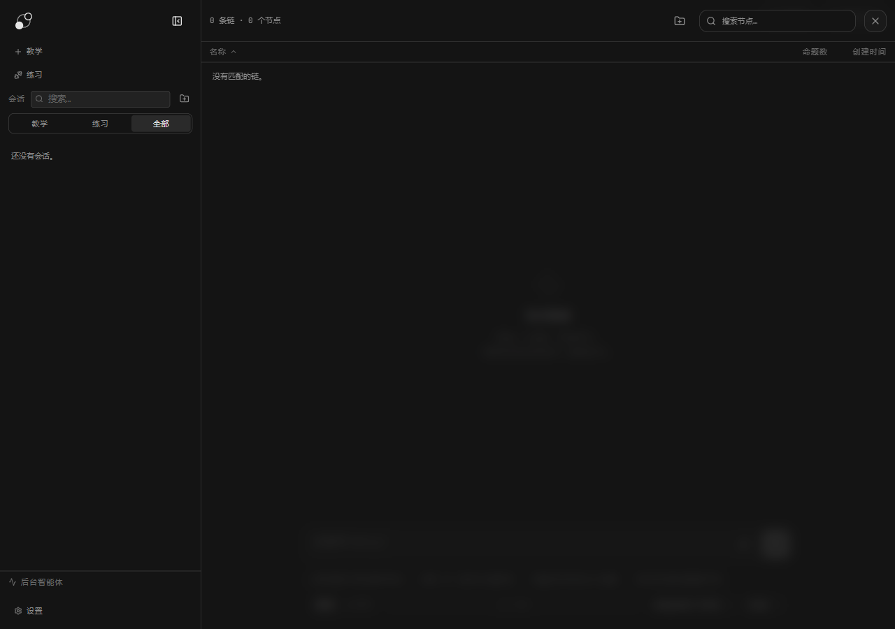
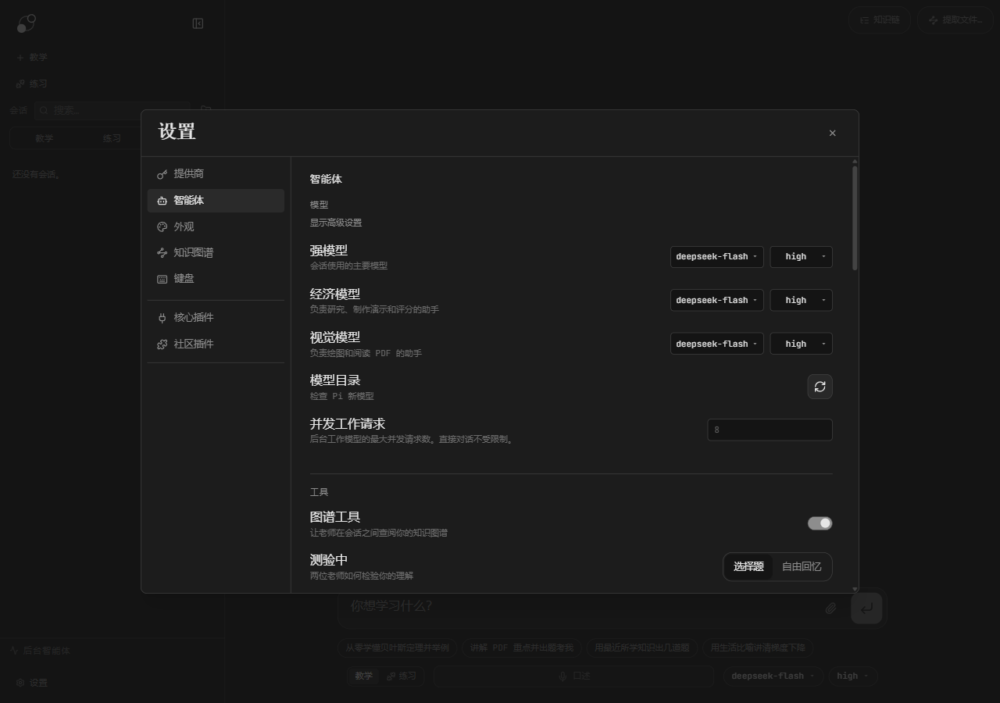

<p align="right">
  <a href="README.md">简体中文</a> ·
  <a href="README.en.md">English</a> ·
  <a href="README.ja.md">日本語</a>
</p>

<p align="center">
  
</p>

<p align="center"><strong>学習のためのエージェントフレームワーク。</strong></p>

<p align="center">
  <a href="https://github.com/xipantingfeng/learn-harness-zh/releases/latest"></a>
  
</p>

<p align="center">
  <a href="https://github.com/xipantingfeng/learn-harness-zh/releases/latest">ダウンロード</a> ·
  <a href="#特徴">特徴</a> ·
  <a href="#仕組み">仕組み</a> ·
  <a href="docs/README.md">ドキュメント</a> ·
  <a href="https://github.com/xipantingfeng/learn-harness-zh/issues">Issue</a>
</p>

知学 1.0 は、現在の理解度から出発して AI エージェントが学習計画を立て、学習に合わせてその理解モデルを更新します。説明を出すだけではありません。回答、確信度、考えた過程が「次に進むか」「例を変えるか」「問題を出すか」を決めます。学んだ内容は永続的なナレッジグラフに蓄積され、セッションをまたいで引き継がれます。



## 特徴

- **見える計画。** 教授の前に依存関係マップを提示し、開始前に承認または修正できる確認カードが表示されます。
- **返信直後の操作。** もっと簡単に、もっと詳しく、別の例、わからない、要約、クイズ——すべて入力欄に事前入力するだけで、自動送信はしません。
- **一行の例prompt。** ホーム画面に 4 つの具体的な例が一行で並び、クリックすると入力欄に入り、そのまま送信できます。
- **引き継がれる知識。** 命題と推論の連鎖が元セッションへのリンクとともに保存され、以降の教授・練習がゼロから始めずにグラフを読み取ります。
- **ローカルファースト。** 会話、グラフ、設定、キーはすべてローカルに保存されます。アプリ内アップデートは既定で無効です。
- **3 プラットフォーム。** Windows、Linux、macOS 用のすぐ実行できるパッケージを提供します。Windows は解凍して `知学.exe` を起動するだけです。



## 仕組み

1. **測定。** 教授の前に、レッスンが依存する各項目で理解がどこまで及ぶかを調べます。回答、確信度、思考が開始点を示します。
2. **計画。** 開始点から目標までの依存マップを作ります。計画は表示され、理解が想定と異なればレッスンは調整されます。
3. **教授。** 各ステップは既に理解している内容の上に積み上がります。予測し、説明を読み、理解を確認します。混乱は次のステップの前に解消されます。
4. **練習。** 別セッションで変形問題を出し、事前に名前を出さずに正しい知識を思い出させるように促します。問題とヒントは推論に合わせて変化します。

**思考を声に出す。** 思考欄では、推論、不確実さ、反応を自分の言葉で書けます。エージェントは正誤の記録ではなく、詳細な理解の像を得ます。入力でも音声でも使えます。

**ファイルを添付。** デスクトップ版ではクリップで PDF や画像を添付、またはドラッグ&ドロップできます。ファイルは元の場所に残り、メッセージがパスを保持してエージェントが読み取ります。

エージェントはバックグラウンド検索、可視化、自分の画像（PDF から切り出したスライドを含む）への注釈、インタラクティブなデモ作成も行えます。

## 引き継がれる知識

教授された内容は命題と推論の連鎖として蓄積されます。グラフはその構造と元セッションへのリンクを示します。ノートの取り込みも可能です。

以降の教授セッションはゼロから始めずグラフを読み、練習セッションはグラフから題材を取ります。保存されるのはIdeaとそのつながりであり、能力の評価値ではありません。



## ダウンロードと開始

**[GitHub Releases からダウンロード](https://github.com/xipantingfeng/learn-harness-zh/releases/latest)**

| プラットフォーム | ファイル | インストール方法 |
| --- | --- | --- |
| Windows x64 | [zhixue-1.0.0-Windows-x64.zip](https://github.com/xipantingfeng/learn-harness-zh/releases/download/v1.0.0/zhixue-1.0.0-Windows-x64.zip) | 解凍して `知学.exe` をダブルクリック |
| Linux x64 | [zhixue-1.0.0-Linux-x64.tar.gz](https://github.com/xipantingfeng/learn-harness-zh/releases/download/v1.0.0/zhixue-1.0.0-Linux-x64.tar.gz) | `tar -xzf ... && cd zhixue-1.0.0-Linux-x64 && bash run.sh` |
| macOS Apple Silicon | [zhixue-1.0.0-macOS-arm64.zip](https://github.com/xipantingfeng/learn-harness-zh/releases/download/v1.0.0/zhixue-1.0.0-macOS-arm64.zip) | 解凍して `知学.app` を開く。必要なら `安装.command` を実行 |
| macOS Intel | [zhixue-1.0.0-macOS-x64.zip](https://github.com/xipantingfeng/learn-harness-zh/releases/download/v1.0.0/zhixue-1.0.0-macOS-x64.zip) | 同上 |
| チェックサム | [SHA256SUMS.txt](https://github.com/xipantingfeng/learn-harness-zh/releases/download/v1.0.0/SHA256SUMS.txt) | `sha256sum -c SHA256SUMS.txt` |

モデルを選び、理解したい内容でセッションを始めます。プロバイダの API キー、デスクトップ版のサブスクリプション接続、インストール済みの Claude Code CLI、カスタム OpenAI 互換エンドポイント（ローカルモデルサーバーを含む）に対応しています。音声入力と Web 検索には別のサービスキーが必要です。

モデルと推論設定は一か所にまとまり、画面全体が中国語で表示されます。



詳細は [入門ガイド](docs/getting-started.md) と [コンテキスト・キャッシュ・コスト](docs/compaction-accounting.md) を参照してください。

## キーとデータ

- **キーとモデル。** サブスクリプションや加金はありません。請求はプロバイダ、CLI、サブスクリプション、またはローカル構成に依存します。コストメーターは既知の API コストのみを推定します。
- **ローカル保存。** 会話、グラフ、設定、キーは `%APPDATA%\知学` に保存されます。学習記録は確認できる通常のファイルです。
- **外部サービス。** モデルは構成したプロバイダ経由で動作し、Web 検索や音声入力も外部サービスに接続します。ローカル保存はオフライン処理を意味しません。
- **動作の透明性。** システムプロンプトは表示・編集可能です。アプリは AGPL-3.0 でオープンソースです。

## 開発とサポート

```bash
npm ci
npm run plugins:setup
npm run dev        # http://localhost:3000
npm test           # fixtures and fake providers
```

その他のガイド：[ドキュメント一覧](docs/README.md)、[開発](docs/development.md)、[アーキテクチャ](docs/architecture.md)、[ショートカット](docs/keyboard.md)、[デスクトップビルド](docs/zh-CN/build-windows.md)。

質問やバグ報告は [GitHub Issues](https://github.com/xipantingfeng/learn-harness-zh/issues) へ。セキュリティ問題は [SECURITY.md](SECURITY.md) に従って非公開で報告してください。

## ライセンス

[AGPL-3.0](LICENSE)。LearnHarness のコードを含み、帰属と変更内容は [NOTICE](NOTICE) に記載しています。アプリは永続的に無料・オープンです。将来的に利便性のためのサービスに料金が発生しても、ローカルで動く機能が有料になることはありません。
