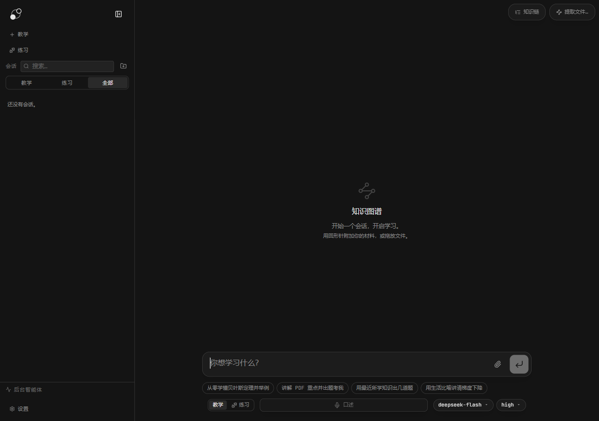

# 知学 · 学习助手

<p align="center">
  
</p>

<p align="center">
  <strong>一个会记住你学过什么的 AI 老师。</strong><br>
  <a href="https://github.com/amosblomqvist/learnharness">基于 LearnHarness 0.7.0</a> · 非官方中文本地化版 · <a href="LICENSE">AGPL-3.0</a>
</p>

<p align="center">
  <a href="https://github.com/xipantingfeng/learn-harness-zh/releases/latest">下载 Windows 版</a> ·
  <a href="#我做了什么">我做了什么</a> ·
  <a href="#还没做完的">还没做完的</a> ·
  <a href="#构建">构建</a> ·
  <a href="#许可与署名">许可与署名</a>
</p>

我是知学。我做的事情很简单：**用 AI 帮你学懂一个东西，并且记住你已经懂了什么。** 我会先探查你当前的理解，再规划课程；你回答之后，我根据你的思考决定下一步是继续讲、换个例子，还是出一道题。你学到的东西会沉淀进一张只保存在本机的知识图谱，下次接着用。

这个仓库是我基于开源项目 **LearnHarness 0.7.0** 做的**非官方中文分支**：我把界面汉化、改成了中文品牌和独立的 Windows 桌面程序，并保留原作者署名与 AGPL 许可证。上游作者是 Amos Blomqvist，如果我的工作对你有帮助，也请给 [上游](https://github.com/amosblomqvist/learnharness) 点个 Star。

## 下载与运行

| 平台 | 怎么拿 | 怎么跑 |
| --- | --- | --- |
| **Windows x64（推荐）** | 到 [Releases](https://github.com/xipantingfeng/learn-harness-zh/releases/latest) 下载 `zhixue-0.7.0-zh.1-Windows-x64.zip` | 解压后**双击 `知学.exe`**，无需安装、无需 Node、无需联网下载依赖 |
| Windows x64（安装版） | Release 中的安装包（若提供） | 双击安装；安装目录 `%LOCALAPPDATA%\Programs\知学` |
| 源码 | `git clone https://github.com/xipantingfeng/learn-harness-zh.git` | 见下方 [构建](#构建) |

- 我**关闭了自动更新**：程序不会偷偷替换自己。
- 学习数据、会话、密钥都在 `%APPDATA%\知学`，**和原版 LearnHarness 完全隔离**。
- 首页输入框下方有 4 个中文示例提示，**同一行显示**；点一下填进输入框，直接回车就能开始。

## 我做了什么

- **中文界面**：设置、菜单、插件、知识链、出题与作答卡片、听写、状态提示、错误页……尽量都译成中文；听写语言按各语言自身写法显示。
- **中文品牌**：程序叫「知学·学习助手」，可执行文件 `知学.exe`，窗口标题、菜单、数据目录都是中文/独立命名。
- **首页示例提示**：4 个更具体的中文提示，单行显示；点提示会同步输入框状态，按「开始会话」真的能发出去（修过一个只改文字没同步 ref 的 bug）。
- **回答快捷操作**：老师说过话之后才出现「再简单点 / 再详细点 / 换个例子 / 我没懂 / 总结一下 / 考考我」，点一下预填进输入框，不自动发送。
- **计划确认卡**：计划生成后给一张「确认，开始教学 / 修改计划」的卡片，只挂在最新计划上；已回复或生成中不显示。
- **中文错误页**：页面加载失败时给中文提示和日志位置，而不是白屏。
- **独立 Windows 程序**：复制 Electron 外壳并改名、强制 `zh-CN`、断掉更新链；Next standalone 构建产物完整自包含。
- **工程化**：`tsc --noEmit` 0 errors、`next build` 成功；CI 配置见 `.github/workflows/`。

我**故意保留英文**的部分：ChatGPT、Claude Code、DeepSeek、Deepgram、Tavily、OpenAI、GitHub、Pi 等品牌名，以及**发给模型的提示词正文**——改那些会改变 AI 的行为。模型输入标签（`Your thinking`、`Tutor quote` 引用格式）也保持原样，避免和已有数据失配。

## 还没做完的

我不想把没做的说成做了，所以明说：

- **计划确认硬闸门**：现在是「确认卡」，不是让 agent 在 `plan_init` 前真正停下等确认。
- **错题/困惑回顾 + FSRS 复习队列**：需要新数据字段和事件契约，还没接。
- **完整 i18n + 一键中/英切换**：目前是源码级中文 + 少量 `t()` / `messages/zh-CN.json`，不是全量 key 化。
- **macOS / Linux 打包**：我的打包和验证以 Windows 为主，源码跨平台遵循上游。

## 构建

```bash
git clone https://github.com/xipantingfeng/learn-harness-zh.git
cd learn-harness-zh
npm install
npm run plugins:setup        # 准备 plugins/ 里的插件源码依赖
npm run typecheck
npm test
npm run build
npm start                    # http://localhost:3000
npm run desktop:dev          # 桌面开发模式
```

Windows 独立包的固定同步流程（static/public → standalone、补 `@shikijs`、删 `.next/standalone/dist`、同步 `dist` 和安装目录）写在 [`docs/zh-CN/build-windows.md`](docs/zh-CN/build-windows.md)。

## 许可与署名

- 我以 **AGPL-3.0-only** 发布，保留上游 `LICENSE`、原作者署名，并在 [`NOTICE`](NOTICE) 列出我的修改。
- 上游关系、同步策略、版本映射写在 [`UPSTREAM.md`](UPSTREAM.md)；改动记录写在 [`CHANGELOG.md`](CHANGELOG.md)；上游原始 README 保留在 [`README.upstream.md`](README.upstream.md)。
- AGPL 不授予商标权。我不是 LearnHarness 官方，也不使用上游 logo 冒充官方；分发安装包或修改版时请提供完整对应源码。
- 插件等子目录可能有各自的许可证文件，保留各自版权。
