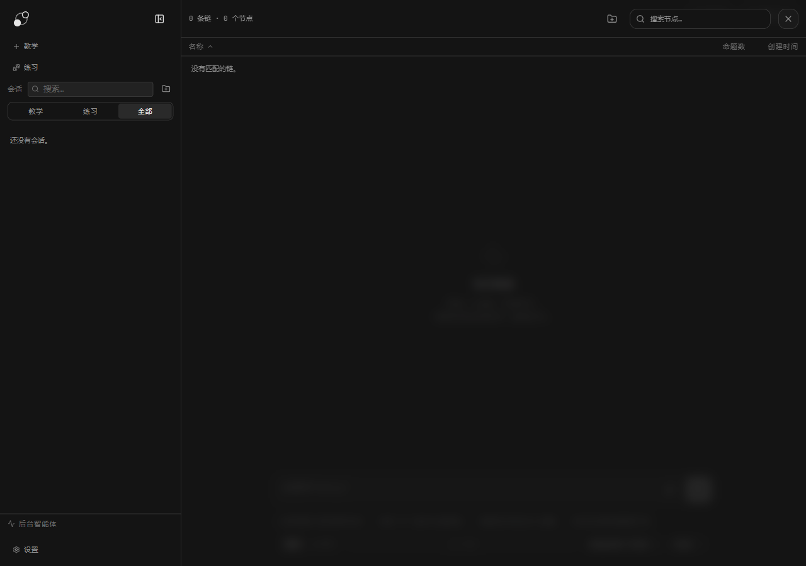
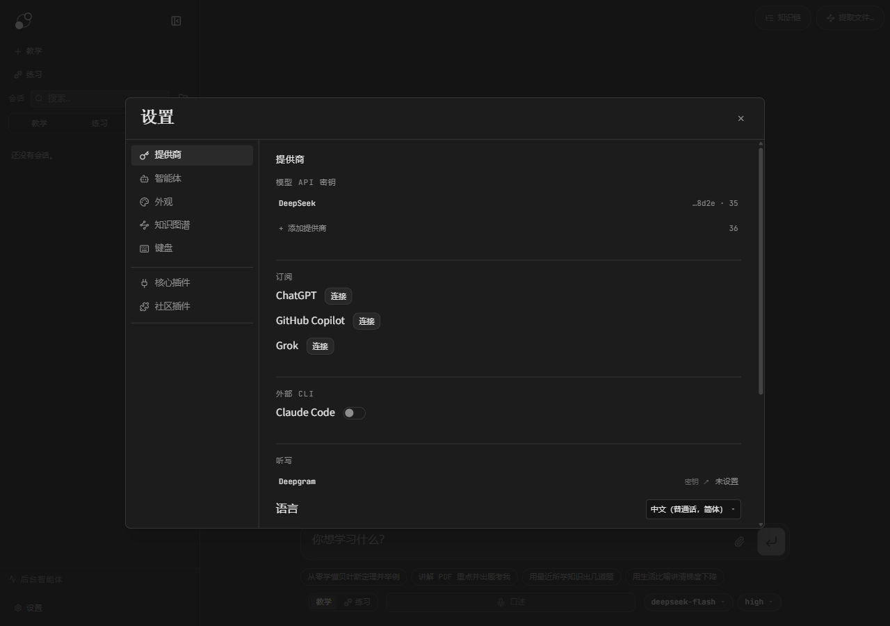

<p align="right">
  <a href="README.md">简体中文</a> ·
  <a href="README.en.md">English</a> ·
  <a href="README.ja.md">日本語</a>
</p>

<p align="center">
  
</p>

<p align="center"><strong>一个用于学习的智能体框架。</strong></p>

<p align="center">
  <a href="https://github.com/xipantingfeng/learn-harness-zh/releases/latest">下载</a> ·
  <a href="#工作原理">工作原理</a> ·
  <a href="docs/README.md">文档</a> ·
  <a href="https://github.com/xipantingfeng/learn-harness-zh/issues">问题反馈</a>
</p>

知学 1.0 用 AI 智能体从你当前的理解出发规划课程，并在学习过程中不断更新对你的认知。它不只是给解释：你的回答、置信度和思考过程决定了下一步是继续讲、换例子，还是出题。学到的内容沉淀在持久知识图谱中，跨会话延续。


## 亮点

- **看得见的计划**：教学前先给出依赖图，确认卡让你在开始前批准或修改，而不是直接开讲。
- **回答级快捷操作**：再简单点、再详细点、换个例子、我没懂、总结一下、考考我——只预填，不替你发送。
- **一行式示例提示**：首页四个具体提示同排显示，点一下填入输入框即可发送。
- **知识会延续**：命题与推理链连同来源会话一起保存，后续教学和练习直接读取，不必每次从零开始。
- **本地优先**：会话、图谱、设置与密钥都在本机；应用内更新默认关闭，程序不会自行替换。
- **三平台可用**：Windows、Linux、macOS 均提供可直接运行的包；Windows 包解压后双击 `知学.exe` 即可。

## 工作原理

1. **探查。** 教学前，智能体先找出你在这门课依赖的每个环节上的理解边界。你的回答、置信度和思考说明它该从哪里开始。
2. **规划。** 从起点到目标生成依赖图。计划可见，如果你的理解与预设不同，课程会随之调整。
3. **教学。** 每一步都建立在你已经理解的内容上。你先预测，再看解释，然后检验理解；困惑在继续之前被修复。
4. **练习。** 独立会话提出变式题，要求你在没有被先点名的情况下想起正确的知识。题目与提示根据你的推理调整。

**说出思考。** 思考字段让你用自己的话写下推理、疑问和反应，智能体由此形成细节丰富的认知图像，而不只是对错记录。支持打字或口述。

**带上文件。** 在桌面版里可以用回形针附加 PDF、图片等文件，或直接拖入。文件留在原处，消息只携带路径，智能体从那里读取。

智能体还可以在后台检索资料、生成可视化说明、在课程中展示并标注你自己的图片（包括从 PDF 中裁出的幻灯片），以及构建交互式演示。

## 知识会延续

教学内容以命题和推理链的形式积累：每一条主张，以及导向它的前提。图谱展示这种结构，并保留回到来源会话的链接。你也可以导入笔记。

后续教学会话读取图谱而不是从零开始，练习会话则从图谱中取材料。它保存的是想法及其联系，而不是对你的能力评分。



## 下载与开始

**[从 GitHub Releases 下载](https://github.com/xipantingfeng/learn-harness-zh/releases/latest)**

- **Windows (x64)：** 解压压缩包，运行 `知学.exe`。无需安装、无需 Node.js、无需下载依赖。
- **Linux (x64)：** 解压后运行 `bash run.sh`，或赋予 `zhixue` 可执行权限后直接运行。
- **macOS (Apple Silicon / Intel)：** 解压后打开 `知学.app`。若被 Gatekeeper 拦截，右键选择“打开”。包内附 `安装.command` 用于设置执行权限。

选择模型后，用你想理解的内容开启一个会话。可以使用提供商 API 密钥、桌面版订阅连接、已安装的 Claude Code CLI，或自定义 OpenAI 兼容端点（含本地模型服务）。听写与网页检索需要单独的服务密钥。

模型与密钥的入口集中在设置里，界面与状态提示均为中文：



更多内容见 [入门指南](docs/getting-started.md) 与 [上下文、缓存与成本](docs/compaction-accounting.md)。

## 你的密钥与数据

- **密钥与模型。** 没有订阅或加价；账单取决于你的提供商、CLI 配置、订阅或本地方案。成本计数器只估算已知 API 成本，不涵盖订阅、CLI 或自定义端点。
- **本地存储。** 会话、图谱、设置和密钥保存在本机 `%APPDATA%\知学`。学习记录是可以直接查看的普通文件。
- **外部服务。** 模型通过你配置的提供商运行；网页检索与听写也会访问外部服务。本地存储不等于离线处理。
- **可检查的行为。** 系统提示词可见、可编辑。应用以 AGPL-3.0 开源。

## 开发与支持

```bash
npm ci
npm run plugins:setup
npm run dev        # http://localhost:3000
npm test           # fixtures and fake providers
```

完整指南见 [文档索引](docs/README.md)、[开发说明](docs/development.md)、[架构](docs/architecture.md)、[快捷键](docs/keyboard.md) 与 [桌面打包](docs/zh-CN/build-windows.md)。

问题、缺陷与功能建议：[GitHub Issues](https://github.com/xipantingfeng/learn-harness-zh/issues)。
安全问题请按 [SECURITY.md](SECURITY.md) 私下报告，不要提交公开 issue。

## 许可

[AGPL-3.0](LICENSE)。包含来自 LearnHarness 的代码，署名与修改说明见 [NOTICE](NOTICE)。应用永久免费开源；若未来提供收费服务，也仅针对托管与密钥管理等便利，而不是本地可运行的功能。
